# 🎬 Netflix Data Analysis Using Python

## 📊 Internship Project – Data Analysis Using Python

This project is based on Netflix content data analysis using Python.

The project focuses on data cleaning, exploratory data analysis, 

visualization, trend analysis, country-wise analysis, rating & 

genre analysis, and business insights.

---

## 🎯 Project Objectives

- 🧹 Clean and prepare the Netflix dataset
- 📊 Analyze Movies and TV Shows
- 🌍 Analyze Netflix content by country
- 📈 Analyze content trends by release year
- ⭐ Analyze content ratings and genres
- 💼 Generate useful Netflix business insights
- 📊 Create visual dashboards using Python

---

## 🛠️ Technologies Used

- 🐍 Python
- 🐼 Pandas
- 🔢 NumPy
- 📊 Matplotlib
- 📈 Seaborn
- 📓 Jupyter Notebook
- 💻 VS Code

---

## 📂 Dataset Information

The dataset contains **8,790 records** and **10 columns**.

### Dataset Columns

| Column | Description |
|---|---|
| `show_id` | Unique ID of the content |
| `type` | Movie or TV Show |
| `title` | Title of the content |
| `director` | Director information |
| `country` | Country of production |
| `date_added` | Date added to Netflix |
| `release_year` | Original release year |
| `rating` | Content rating |
| `duration` | Movie/TV Show duration |
| `listed_in` | Genre/category information |

---

# 📌 Tasks Completed

## 🧹 Task 1 – Netflix Data Cleaning & Preparation

Performed:

- 📥 Dataset loading using Pandas
- 🔍 Dataset inspection
- ❌ Missing-value checking
- 🔁 Duplicate-value checking
- 🧹 Data cleaning
- ✨ Formatting standardization
- 💾 Exported cleaned dataset

### Output

`Cleaned_Netflix_Dataset.csv`

---

## 📊 Task 2 – Content Type Analysis Dashboard

Analyzed the distribution of:

- 🎬 Movies
- 📺 TV Shows

### Results

- 🎬 Movies: **6,126**
- 📺 TV Shows: **2,664**

Created visualizations:

- 📊 Bar Chart
- 🥧 Pie Chart

### Screenshot

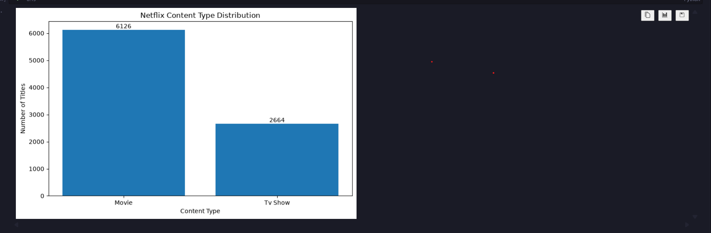

---

## 🌍 Task 3 – Country-Wise Netflix Content Analysis

Performed country-wise content analysis by:

- 🌎 Extracting country information
- 🧹 Cleaning country values
- 📊 Counting content by country
- 🏆 Finding top content-producing countries
- 📈 Creating Top 10 Countries visualization

### Screenshot

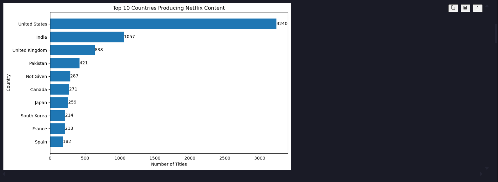

---

## 📈 Task 4 – Trend Analysis by Release Year

Analyzed Netflix content according to release year.

Performed:

- 📅 Year-wise content counting
- 📈 Release trend analysis
- 🔍 Identification of peak release year
- 📊 Trend visualization

### Screenshot

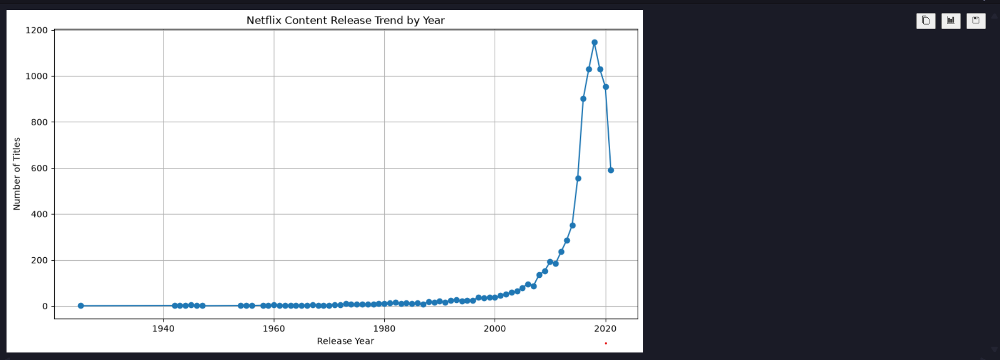

---

## ⭐ Task 5 – Content Rating & Genre Analysis

Analyzed:

- ⭐ Content ratings
- 🎭 Netflix genres
- 🎬 Movies vs TV Shows by rating
- 📊 Most common genres

Created:

- ⭐ Rating Distribution Chart
- 🎭 Top 10 Genres Chart
- 📊 Rating Comparison Chart

### Screenshots

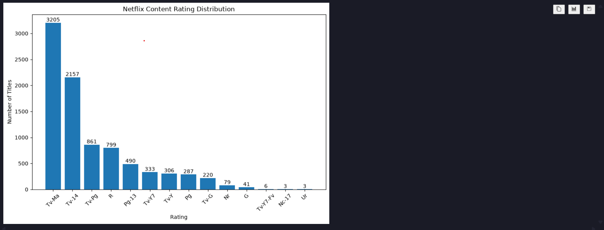

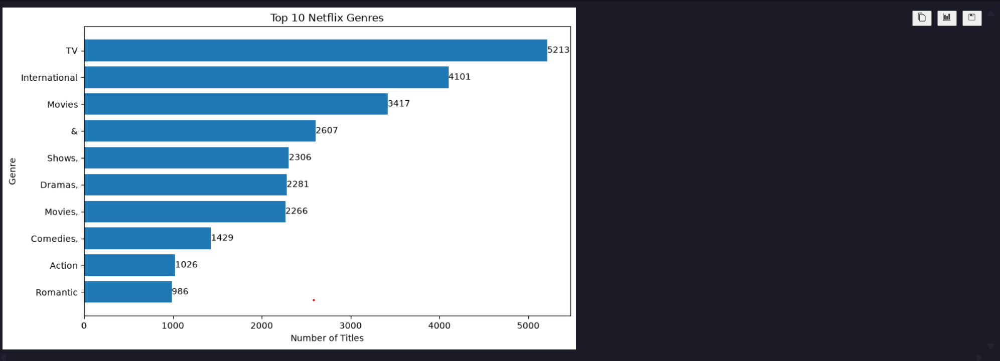

---

# 💼 Task 6 – Netflix Business Insights Report

Created a final business insights dashboard containing:

- 🎬 Movies vs TV Shows
- 🌍 Top 10 Countries
- 🎭 Top 10 Genres
- 📈 Release Year Trend

### Final Dashboard

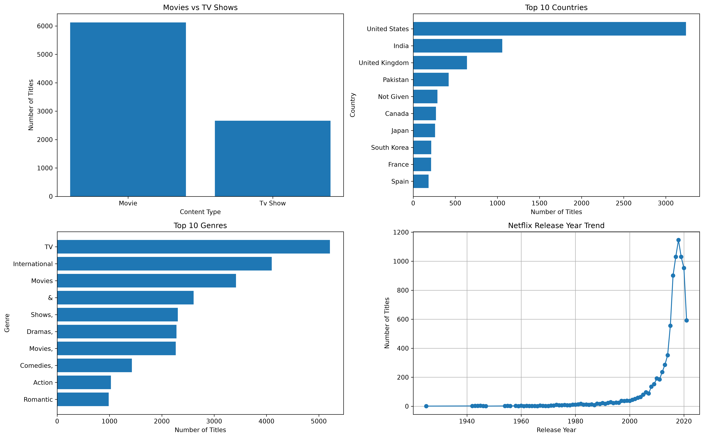

### Business Insights

The project identifies:

- 📊 Total Netflix titles
- 🎬 Total Movies
- 📺 Total TV Shows
- ⭐ Most common content rating
- 🎭 Most common genre
- 🌍 Top content-producing country
- 📅 Peak release year

---

# 📊 Project Visualizations

### 🎬 Content Type Distribution

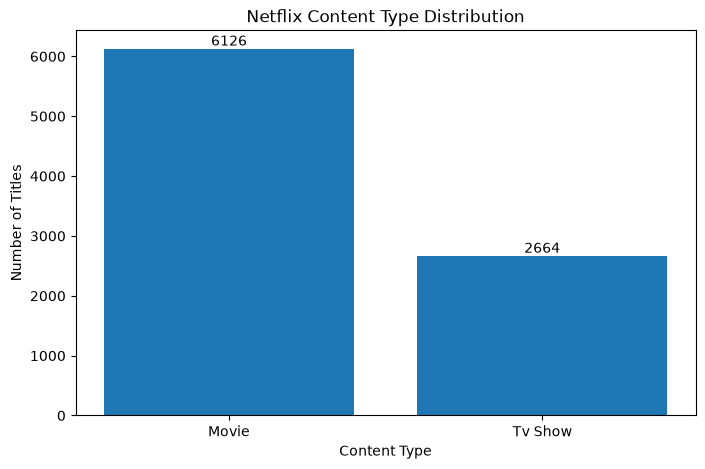

### 🥧 Movies vs TV Shows

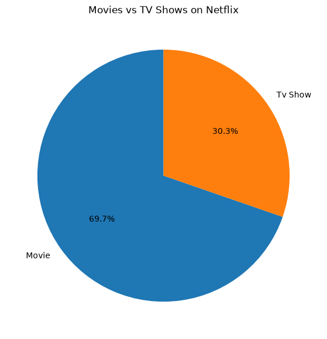

### 🌍 Top 10 Countries


### 📈 Release Year Trend


### ⭐ Content Rating Distribution

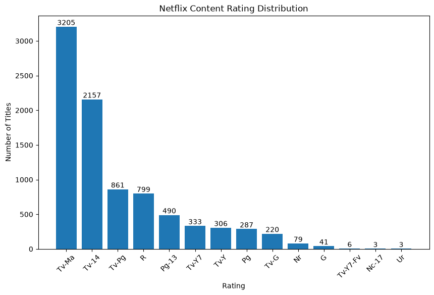

### 🎭 Top 10 Genres

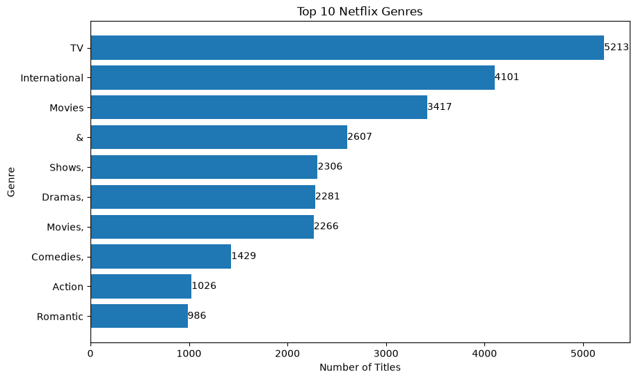

### 📊 Rating Comparison

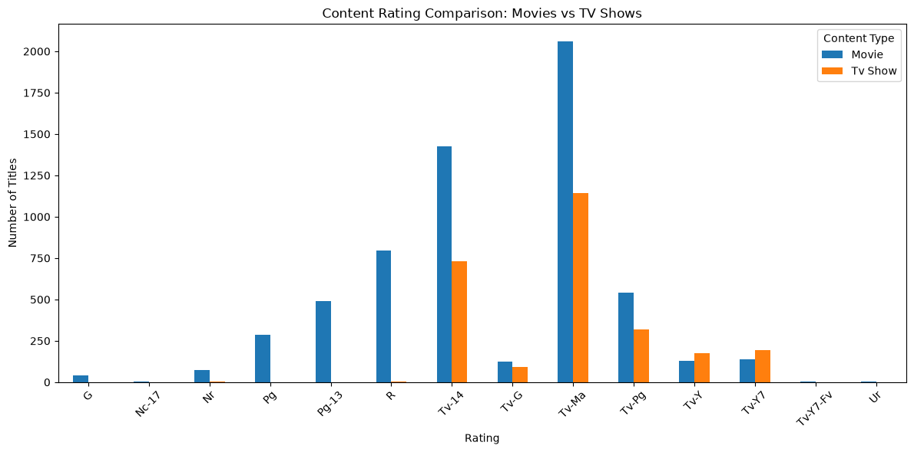

---

# 📸 Task Screenshots

### Task 1 – Dataset & Data Cleaning

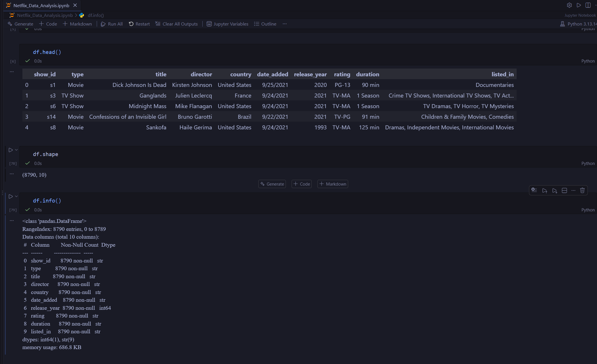

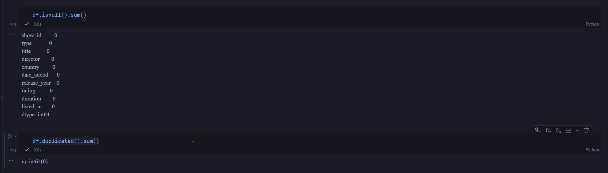

### Task 2 – Content Type Analysis


### Task 3 – Country Analysis


### Task 4 – Release Year Trend


### Task 5 – Rating & Genre Analysis


### Task 6 – Business Dashboard


---

# 📁 Project Structure

```text
Netflix_Data_Analysis/
│
├── 📓 Netflix_Data_Analysis.ipynb
├── 📄 Dataset.csv
├── 📄 Cleaned_Netflix_Dataset.csv
├── 📄 README.md
│
├── 📊 charts/
│   ├── content_type_distribution.png
│   ├── movies_vs_tv_shows.png
│   ├── top_10_countries.png
│   ├── release_year_trend.png
│   ├── content_rating_distribution.png
│   ├── top_10_genres.png
│   ├── rating_comparison.png
│   └── final_netflix_dashboard.png
│
├── 📸 screenshots/
│   ├── task1_1.png
│   ├── task1_2.png
│   ├── task2.png
│   ├── task3.png
│   ├── task4.png
│   ├── task5_1.png
│   ├── task5_2.png
│   └── task6.png
│
└── 📑 report/
    └── netflix_business_insights.csv
```

---

# ▶️ How to Run the Project

### 1️⃣ Clone the repository

```bash
git clone YOUR_GITHUB_REPOSITORY_LINK
```

### 2️⃣ Open the project

```bash
cd Netflix_Data_Analysis
```

### 3️⃣ Install required libraries

```bash
pip install pandas numpy matplotlib seaborn jupyter
```

### 4️⃣ Start Jupyter Notebook

```bash
jupyter notebook
```

### 5️⃣ Open

`Netflix_Data_Analysis.ipynb`

### 6️⃣ Run all cells

Execute the notebook cells from top to bottom.

---

# 📌 Key Skills Demonstrated

- 🐍 Python Programming
- 🐼 Pandas
- 🔢 NumPy
- 🧹 Data Cleaning
- 🔍 Exploratory Data Analysis
- 📊 Data Visualization
- 📈 Trend Analysis
- 🌍 Country-wise Analysis
- ⭐ Rating Analysis
- 🎭 Genre Analysis
- 💼 Business Insights
- 📓 Jupyter Notebook

---

# 🎓 Internship Learning Outcome

Through this project, practical experience was gained in:

- Data preprocessing
- Data cleaning
- Exploratory Data Analysis
- Visualization
- Business-oriented analysis
- Dashboard creation
- Python-based data analysis

---

# 👨‍💻 Author

**Swayam Vekariya**

🎓 BCA Graduate

💻 Aspiring Data Analyst / Python Developer

---

## ⭐ If you found this project useful, don't forget to star the repository!

⭐ **Thank You for Visiting!** 🚀
